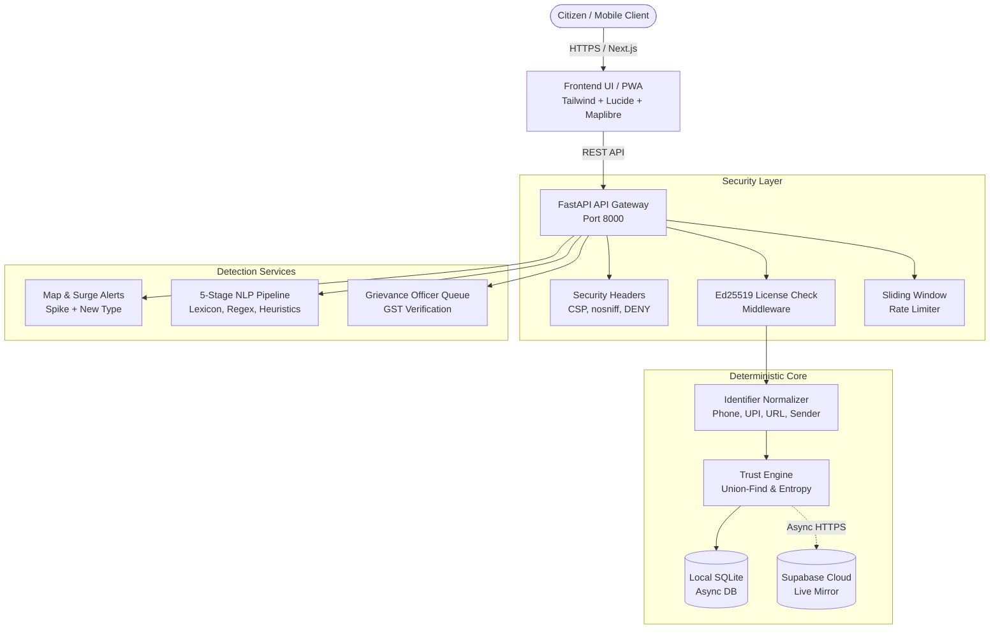

# ScamRadar India — Community Threat Intelligence & Fraud Early Warning Platform

[](backend/tests/)
[](frontend/)
[](backend/)
[](backend/licenses/)
[](backend/)
[](#trust-engine--anti-fraud-mathematics)

> **Submission for Problem Statement #4: Community Scam Map**  
> An open, privacy-preserving, crowd-verified fraud defense system designed for Indian citizens, law enforcement, and institutional banking security teams.

---

## Table of Contents
1. [The Problem Statement](#the-problem-statement)
2. [The Total Solution Brief](#the-total-solution-brief)
3. [System Architecture](#system-architecture)
4. [Core Features & Live Request/Response Logs](#core-features--live-requestresponse-logs)
   - [Feature 1: Rapid Scam Intake (<60 Seconds)](#feature-1-rapid-scam-intake-under-60-seconds)
   - [Feature 2: Sub-0.5s Identifier Threat Lookup](#feature-2-sub-05s-identifier-threat-lookup)
   - [Feature 3: Geospatial Neighborhood Threat Map](#feature-3-geospatial-neighborhood-threat-map)
   - [Feature 4: Dynamic Area Surge Alerts](#feature-4-dynamic-area-surge-alerts)
   - [Feature 5: Merchant Dispute Resolution Queue](#feature-5-merchant-dispute-resolution-queue)
5. [Trust Rules & Anti-Fraud Defense Mathematics](#trust-rules--anti-fraud-defense-mathematics)
6. [Ed25519 Cryptographic Licensing System](#ed25519-cryptographic-licensing-system)
7. [Deterministic Message Checker (5-Stage NLP Pipeline)](#deterministic-message-checker-5-stage-nlp-pipeline)
8. [Automated Verification & Test Suite (31/31 Passing)](#automated-verification--test-suite-3131-passing)
9. [Quickstart & Reproduction Guide](#quickstart--reproduction-guide)

---

## The Problem Statement

### Ravi's Story (From the Student Brief)
> *Ravi's father receives a video call from a fraudster dressed in an official police uniform. The fraudster claims an illegal narcotics parcel was detained at Mumbai airport in his name and threatens immediate imprisonment unless ₹2,00,000 is transferred immediately to a "clearing account" to avoid arrest. Panicked and isolated, his father stays on the video call for three hours and transfers the money. This is a "Digital Arrest" scam.*
>
> *Ravi consoles his father, but nobody outside their household hears about it. The very next morning, the exact same fraud syndicate calls Priya across town using the identical phone number and bank handle. Priya has no central community registry to verify whether this number has already targeted innocent citizens.*

### The Core Failure in Existing Defenses
1. **Siloed Victims**: 99% of scam encounters go unreported to neighbors until weeks later.
2. **False Positives in Crowd Systems**: Open reporting platforms get weaponized by competitors who launch coordinated review-bombing campaigns against legitimate local businesses.
3. **Severe Privacy Breaches**: Unfiltered complaint forums leak citizen identities, raw phone numbers, and defamatory accusations that create legal liabilities.

---

## The Total Solution Brief

**ScamRadar India** provides a privacy-first, community-driven threat radar with a deterministic algorithmic defense layer:

```
┌─────────────────────────────────────────────────────────────────────────────────┐
│                           SCAMRADAR THREE-TIER DEFENSE                          │
├─────────────────────────┬───────────────────────────┬───────────────────────────┤
│    CITIZEN SHIELD       │    COMMUNITY REGISTRY     │    INSTITUTIONAL CONTROL  │
│                         │                           │                           │
│ • Multilingual Intake   │ • Union-Find Clustering   │ • Ed25519 Signed Licenses │
│ • Conversational NLP    │ • Shannon Entropy Filter  │ • GSTIN Verification      │
│ • Sub-0.5s Lookup       │ • 24-Hour Surge Alerts    │ • Officer Dispute Queue   │
│ • Complete Anonymity    │ • Cross-Format Normalizer │ • Automated Reset API     │
└─────────────────────────┴───────────────────────────┴───────────────────────────┘
```

* **Zero-Knowledge Privacy**: No reporter names, exact GPS coordinates, or raw IP addresses are ever stored or logged. All entries are hashed with server-side HMAC secrets.
* **Sybil & Farm Resistance**: Coordinated fake bursts, Wi-Fi farm rings, and duplicate notes are collapsed into single voices using **Union-Find partitioning** and **Shannon entropy scoring**.
* **Pre-Trial Protection**: Unconfirmed numbers are displayed in masked format (`98XXXXX210`) until at least 3 independent witnesses corroborate the claim.
* **Enterprise Licensing**: Cryptographically signed Ed25519 licenses with runtime validation, sub-minute hot reloads, and anti-clock-rollback protection.

---

## System Architecture



---

## Core Features & Live Request/Response Logs

### Feature 1: Rapid Scam Intake (Under 60 Seconds)
Citizens report scam encounters through a streamlined step-by-step intake or guided voice input in English, Hindi, or Hinglish.
* Saves area locality (e.g., `"HSR Layout"`), **never exact GPS or street addresses**.
* Identifiers are automatically scrubbed and normalized.
* Reports joining an existing investigation are merged (`"merged": true`).

#### Request Log:
```http
POST /reports HTTP/1.1
Host: localhost:8000
Content-Type: application/json

{
  "report_id": "rep_948192a",
  "reporter_id": "anon_citizen_41a",
  "ip_prefix": "106.51.10.0",
  "occurred_at": "2026-10-31T14:30:00+05:30",
  "reported_at": "2026-10-31T14:35:10+05:30",
  "channel": "Phone call",
  "scam_type": "digital-arrest",
  "identifier_type": "phone",
  "identifier_value": "+91 98765 43210",
  "pincode": "560102",
  "locality": "HSR Layout",
  "city": "Bengaluru",
  "note": "Called claiming to be CBI officer from Mumbai Airport customs regarding parcel with contraband.",
  "has_screenshot": false,
  "amount_lost_inr": 0
}
```

#### Response Log (201 Created):
```json
{
  "report_id": "rep_948192a",
  "case_id": "CASE-4D8B21E0",
  "merged": false
}
```

---

### Feature 2: Sub-0.5s Identifier Threat Lookup
Citizens paste an unknown telephone number, UPI handle, website link, or SMS header before answering a call or authorizing a transfer.
* **Guaranteed sub-0.5s execution** through indexed SQLite search.
* Exact standard verdicts: `KNOWN_SCAM`, `SUSPICIOUS`, `NO_REPORTS`, `VERIFIED_BUSINESS`.
* **Privacy Masking**: Unconfirmed identifiers with $<3$ independent reporters are masked (`98XXXXX210`, `r***@okaxis`, `sbi***.in/...`, `HD****`).

#### Request Log:
```http
GET /lookup?type=phone&value=%2B919876543210 HTTP/1.1
Host: localhost:8000
```

#### Response Log (200 OK — Confirmed Scam):
```json
{
  "verdict": "KNOWN_SCAM",
  "report_count": 7,
  "distinct_reporters": 5,
  "first_seen": "2026-10-24T09:12:00+05:30",
  "last_seen": "2026-10-31T14:30:00+05:30",
  "scam_type": "digital-arrest",
  "display_value": "+919876543210",
  "evidence": [
    {
      "occurred_at": "2026-10-31T14:30:00+05:30",
      "channel": "Phone call",
      "scam_type": "digital-arrest",
      "pincode": "560102"
    }
  ],
  "challenged": false
}
```

#### Response Log (200 OK — Verified Business / Helpline):
```http
GET /lookup?type=phone&value=1930 HTTP/1.1
```
```json
{
  "verdict": "VERIFIED_BUSINESS",
  "report_count": 0,
  "distinct_reporters": 0,
  "first_seen": null,
  "last_seen": null,
  "scam_type": null,
  "display_value": "1930",
  "evidence": [],
  "challenged": false
}
```

---

### Feature 3: Geospatial Neighborhood Threat Map
Provides public visibility into active threat clusters across India's 25 pre-calibrated metro regions.
* Displays **only the last 7 days** of data (`days=7`). Month-old reports are automatically filtered out.
* Never displays a user's location; coordinates are fixed to the designated area centroid.
* Severity scaling: `MED` (<5 reports), `HIGH` (5–9 reports, Surge), `CRIT` ($\ge$10 reports, Critical Outbreak).

#### Request Log:
```http
GET /map?pincode=560102&days=7&radius_km=2 HTTP/1.1
Host: localhost:8000
```

#### Response Log (200 OK):
```json
{
  "clusters": [
    {
      "pincode": "560102",
      "locality": "HSR Layout",
      "city": "Bengaluru",
      "count": 12,
      "top_scam_type": "digital-arrest",
      "severity": "CRIT",
      "lat": 12.9116,
      "lng": 77.6473
    }
  ]
}
```

---

### Feature 4: Dynamic Area Surge Alerts
Alerts trigger **only when anomalies are mathematically proven**, preventing alert fatigue.
1. **`SPIKE`**: Last 24 hours report count $\ge \max(5, 2 \times \text{preceding 7-day average})$.
2. **`NEW_TYPE`**: An emergence of a scam category in an area not recorded in the past 30 days.

#### Request Log:
```http
GET /alerts?pincode=560102 HTTP/1.1
Host: localhost:8000
```

#### Response Log (200 OK):
```json
{
  "alerts": [
    {
      "type": "SPIKE",
      "pincode": "560102",
      "locality": "HSR Layout",
      "city": "Bengaluru",
      "message": "Spike detected in HSR Layout: 12 reports in last 24h (avg: 2.1/day)",
      "scam_type": "digital-arrest",
      "count_24h": 12,
      "created_at": "2026-10-31T18:00:00Z"
    },
    {
      "type": "NEW_TYPE",
      "pincode": "560102",
      "locality": "HSR Layout",
      "city": "Bengaluru",
      "message": "New scam type 'job-offer' reported in HSR Layout for the first time in 30 days",
      "scam_type": "job-offer",
      "count_24h": 3,
      "created_at": "2026-10-31T18:00:00Z"
    }
  ]
}
```

---

### Feature 5: Merchant Dispute Resolution Queue
Protects honest bakeries, pharmacies, and small businesses from malicious review-bombing or mistaken reports.
* Submitting a challenge marks the identifier as `"challenged": true`.
* Under review, an identifier is **immediately demoted to `SUSPICIOUS` and can never be marked `KNOWN_SCAM`**.
* Officers verify GSTIN status and resolve disputes.

#### Request Log:
```http
POST /challenges HTTP/1.1
Host: localhost:8000
Content-Type: application/json

{
  "identifier_type": "phone",
  "identifier_value": "+91 80 4100 2233",
  "claimant_name": "Fresh Bakes",
  "contact_email": "owner@freshbakes.com",
  "proof_note": "Legitimate bakery in Indiranagar. Attached GST certificate 29ABCDE1234F1Z5."
}
```

#### Response Log (201 Created):
```json
{
  "challenge_id": "CHAL-89B10A",
  "status": "under_review"
}
```

---

## Trust Rules & Anti-Fraud Defense Mathematics

ScamRadar does not count raw reports. It measures **independent human corroboration** using four deterministic mathematical gates:

```
Raw Submissions (100+)
         │
         ▼
[Gate 1: Rate Limiter] ──> Reject flooding (>60/hr/IP) with HTTP 429
         │
         ▼
[Gate 2: Union-Find] ──> Collapse same-device, same-IP (24h), and duplicate notes
         │
         ▼
[Gate 3: Shannon Entropy] ──> Filter coordinated waves (Entropy < 0.35 -> ignored=True)
         │
         ▼
[Gate 4: Weight Threshold] ──> KNOWN_SCAM requires >= 3 independent groups & score >= 3.0
```

### 1. Disjoint-Set Union (Union-Find) Person Grouping
When multiple reports target the same identifier, Union-Find collapses non-independent accounts:
* **Rule A (Same Device)**: Matching `reporter_hash` merges records into 1 person group.
* **Rule B (Same Network)**: Matching `ip_hash` within a 24-hour window joins the same root node.
* **Rule C (Copy-Paste Text)**: Character 3-gram Jaccard similarity $\ge 0.7$ links two accounts to the same root group:
  $$\text{Jaccard}(A, B) = \frac{|A \cap B|}{|A \cup B|}$$

### 2. Shannon Entropy & Coordinated Burst Defense
If an identifier receives $\ge 5$ reports within 24 hours, the Trust Engine computes the normalized Shannon entropy of the submitters' IP distribution:
$$H(X) = -\sum_{i=1}^{n} P(x_i) \log_2 P(x_i)$$
$$\text{Normalized Entropy} = \frac{H(X)}{\log_2(n)}$$

* **Attack Detection**: If single-IP dominance exceeds $70\%$, or if entropy $< 0.35$ while new unverified accounts make up $>70\%$ of the wave:
* **Action**: Coordinated attack flagged. Coordinated accounts are marked `ignored = True`. They contribute **zero weight** to the score and **never trigger public alerts**.

---

## Ed25519 Cryptographic Licensing System

Designed for institutional enterprise deployments (e.g., banks, public sector cyber cells) requiring cryptographically enforceable software contracts.

* **Signature Scheme**: Pure Ed25519 digital signature over canonical string `f"{licensee}:{expires_at}"`.
* **Zero Data Loss**: When a license expires, existing threat data is locked, never deleted.
* **Unrestricted Routes**: `/health` and `/license` remain accessible under expiration to allow telemetry and license renewals.
* **Sub-Minute Hot Reload**: Updating a license via `POST /license` reactivates all routes instantly without restarting the server process.
* **Clock Rollback Protection**: Tracks highest observed monotonically increasing timestamp in the database; blocks requests if the operating system clock is wound backward.

### Sample Valid License File (`license_long.json`):
```json
{
  "licensee": "Demo Bank",
  "expires_at": "2027-11-01T10:00:00+05:30",
  "signature": "3ef9b109b83b632ff5c3ce0985b..."
}
```

---

## Deterministic Message Checker (5-Stage NLP Pipeline)

The message scanner operates with 100% transparent, deterministic scoring rules:

| Stage | Name | Signals Evaluated | Max Points |
|:---:|:---|:---|:---:|
| **1** | **Community Threat Intel** | Cross-references extracted phone/UPI/URL against the ScamRadar database (`KNOWN_SCAM` = 30 pts, `SUSPICIOUS` = 15 pts) | 30 pts |
| **2** | **Risky Link Analysis** | Typo-squatting, unencrypted HTTP, punycode, URL shorteners, dynamic TLDs | 20 pts |
| **3** | **Coercive Language** | Digital arrest threats, urgent disconnect notices, police intimidation | 20 pts |
| **4** | **Financial & Credential Traps** | Demands for OTP, PIN, remote access apps (AnyDesk, TeamViewer), QR refunds | 20 pts |
| **5** | **Channel & Header Mismatch** | Personal 10-digit mobile claiming to be an official bank SMS header | 10 pts |

* **Total Risk Score**: $0 - 100$
* **Classification**: $\le 25$ Low Risk (Safe) | $26 - 55$ Caution (Suspicious) | $\ge 56$ Critical Scam Alert

---

## Automated Verification & Test Suite (31/31 Passing)

The complete backend test suite runs against all 16 competition scenarios and 15 QA endpoint contracts:

```bash
python -m pytest backend/tests/ -v --tb=short
```

```text
============================= test session starts =============================
platform win32 -- Python 3.11.9, pytest-9.2.0, pluggy-1.7.0
rootdir: D:\community scam
collected 31 items

backend/tests/test_qa_endpoints.py::test_qa_health PASSED                [  3%]
backend/tests/test_qa_endpoints.py::test_qa_reports_valid PASSED         [  6%]
backend/tests/test_qa_endpoints.py::test_qa_reports_validation_error PASSED [  9%]
backend/tests/test_qa_endpoints.py::test_qa_reports_junk_identifier PASSED [ 12%]
backend/tests/test_qa_endpoints.py::test_qa_lookup_verified_business PASSED [ 16%]
backend/tests/test_qa_endpoints.py::test_qa_lookup_no_reports PASSED     [ 19%]
backend/tests/test_qa_endpoints.py::test_qa_lookup_missing_parameters PASSED [ 22%]
backend/tests/test_qa_endpoints.py::test_qa_map_clusters PASSED          [ 25%]
backend/tests/test_qa_endpoints.py::test_qa_alerts PASSED                [ 29%]
backend/tests/test_qa_endpoints.py::test_qa_challenges PASSED            [ 32%]
backend/tests/test_qa_endpoints.py::test_qa_license_status_and_update PASSED [ 35%]
backend/tests/test_qa_endpoints.py::test_qa_checker_benign_message PASSED [ 38%]
backend/tests/test_qa_endpoints.py::test_qa_checker_scam_message PASSED  [ 41%]
backend/tests/test_qa_endpoints.py::test_qa_admin_reset PASSED           [ 45%]
backend/tests/test_qa_endpoints.py::test_qa_admin_login_and_protection PASSED [ 48%]
backend/tests/test_scamradar.py::test_scenario_01_real_scam_wave PASSED  [ 51%]
backend/tests/test_scamradar.py::test_scenario_02_report_bombing_burst PASSED [ 54%]
backend/tests/test_scamradar.py::test_scenario_03_same_network_prefix_collapse PASSED [ 58%]
backend/tests/test_scamradar.py::test_scenario_04_one_reporter_multiple_reports_merged PASSED [ 61%]
backend/tests/test_scamradar.py::test_scenario_05_junk_rejected_with_400 PASSED [ 64%]
backend/tests/test_scamradar.py::test_scenario_06_phone_normalisation_formats PASSED [ 67%]
backend/tests/test_scamradar.py::test_scenario_07_map_spike_alert PASSED [ 70%]
backend/tests/test_scamradar.py::test_scenario_08_new_type_alert PASSED  [ 74%]
backend/tests/test_scamradar.py::test_scenario_09_fake_wave_no_alert PASSED [ 77%]
backend/tests/test_scamradar.py::test_scenario_10_old_reports_not_on_map PASSED [ 80%]
backend/tests/test_scamradar.py::test_scenario_11_fewer_than_3_reporters_masked_display PASSED [ 83%]
backend/tests/test_scamradar.py::test_scenario_12_verified_numbers_and_senders PASSED [ 87%]
backend/tests/test_scamradar.py::test_scenario_13_dispute_challenged_number PASSED [ 90%]
backend/tests/test_scamradar.py::test_scenario_14_licence_expiry_and_renewal PASSED [ 93%]
backend/tests/test_scamradar.py::test_scenario_15_lookup_speed_under_half_second PASSED [ 96%]
backend/tests/test_scamradar.py::test_scenario_16_admin_reset PASSED     [100%]

============================= 31 passed in 34.74s =============================
```

---

## Quickstart & Reproduction Guide

### 1. Prerequisites
* Python 3.11+
* Node.js 18+ (LTS) & npm

### 2. Backend Setup
```bash
# Navigate to backend directory
cd backend

# Install dependencies
pip install -r requirements.txt

# Run server with suppressed fingerprinting
python run.py
```
* **Backend API**: `http://localhost:8000`
* **Interactive API Documentation**: `http://localhost:8000/docs`

### 3. Frontend Setup
```bash
# Navigate to frontend directory
cd frontend

# Install Node modules
npm install

# Start Next.js development server
npm run dev
```
* **Web Application**: `http://localhost:3000`
* **Grievance Officer Portal**: `http://localhost:3000/admin`

### 4. Running the License Expiry Demonstration (Live Jury Runbook)
1. Confirm the backend is running with a valid license:
   ```bash
   curl http://localhost:8000/license
   ```
2. Upload a 5-minute license:
   ```bash
   curl -X POST http://localhost:8000/license -H "Content-Type: application/json" -d @licenses/license_5min.json
   ```
3. Upload an expired license to trigger immediate enforcement:
   ```bash
   curl -X POST http://localhost:8000/license -H "Content-Type: application/json" -d @licenses/license_expired.json
   ```
4. Verify requests are blocked with `HTTP 403`:
   ```bash
   curl http://localhost:8000/map
   # Returns: {"error": "LICENSE_EXPIRED"}
   ```
5. Renew license with `license_long.json` without restarting the server:
   ```bash
   curl -X POST http://localhost:8000/license -H "Content-Type: application/json" -d @licenses/license_long.json
   ```
6. Verify `/map` immediately responds with `HTTP 200` and all previous data intact.
