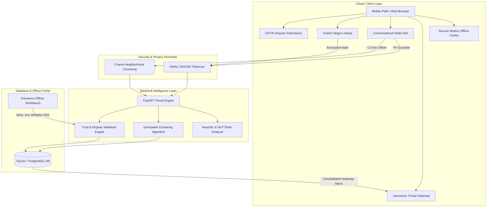

# ScamRadar India // Problem Statement & Total Solution Architecture
**National Community Scam Radar, Identifier Verification, & Citizen Emergency Defense Hub**  
*CyberForge Hackathon 2026 // Problem Statement #4: Community Scam Map for India*

---

## 1. Executive Summary

**ScamRadar India** (also deployed as **Cyberforge Threat Radar**) is a production-ready, privacy-preserving, hyper-local cyber fraud intelligence platform built specifically for the Indian threat landscape. It tackles the rampant explosion of digital arrest extortion, fake electricity disconnection SMS, predatory loan app harassment, and UPI QR code deception by crowdsourcing anonymous scam telemetry while preserving zero-knowledge citizen anonymity under India's Digital Personal Data Protection (DPDP) Act 2023.

The solution features:
1. **Interactive Community Scam Heatmap** with automatic cluster consolidation ($\ge 5$ reports merge into a single perimeter) and real-time community surge alerts.
2. **AI-Powered Conversational Citizen Fraud Intake** with live tactical legal insights (Golden Hour 1930 freezing, CrPC § 41A video arrest prohibition, Electricity Act § 56).
3. **Zero-Knowledge Identifier Verification (Instant Lookup)** for phone numbers, UPI VPAs, URLs, and bank accounts without exposing citizen PII.
4. **Legitimate Business Defense & GSTIN Dispute Resolution Portal** with automated format, state-code, and PAN validation to prevent false-positive collateral damage.
5. **Grievance Officer Workbench** restricted via strict `.env` Gmail whitelisting for designated cyber police and grievance officers.
6. **Mobile-First Progressive Web App (PWA)** featuring offline Service Worker caching of emergency protocols (Helpline 1930), mobile bottom navigation dock, and standalone home screen installability.

---

## 2. Problem Statement: The Indian Cyber Fraud Epidemic

### 2.1 Context & Background
In 2024–2026, cyber financial fraud against Indian citizens surged past ₹15,000+ Crores annually (MHA/I4C NCRP figures). Scammers leverage high-velocity psychological engineering tailored to Indian cultural reflexes: fear of police arrests, fear of utility disconnections, economic vulnerability, and familiarity with UPI payment prompts.

```
+-----------------------------------------------------------------------------------+
|                            THE INDIAN CYBER FRAUD VECTOR                          |
+-----------------------------------------------------------------------------------+
|  1. "Digital Arrest" Extortion  --> Impersonating CBI/Police on Skype/WhatsApp   |
|  2. Electricity Cutoff SMS      --> Fake 9:30 PM disconnection deadline + APKs    |
|  3. Predatory Loan Apps         --> Blackmail via contacts & morphed media        |
|  4. Reverse UPI QR Schemes      --> "Scan QR to receive money" (enters PIN)       |
|  5. Part-Time Task Scams        --> Small ₹150 payouts leading to VIP entrapment   |
+-----------------------------------------------------------------------------------+
```

### 2.2 Critical Vulnerabilities in Existing Solutions
1. **Information Asymmetry & Lag:** When a scam gang launches a campaign in an area (e.g. sending 2,000 electricity disconnection SMS across Bengaluru's Indiranagar), citizens receive messages individually and in isolation. By the time official warnings emerge weeks later, thousands of victims have transferred money.
2. **Privacy Retaliation Fears:** Citizens are reluctant to file public complaints because standard complaint systems expose their phone numbers and addresses, leading to targeted harassment or unwanted police interrogation for small amounts.
3. **Scattered, Fragmented Clusters:** Standard mapping tools display every report as a separate disconnected dot, creating UI clutter and obscuring the true density of coordinated local scam operations.
4. **Collateral Damage to Legitimate Businesses:** Innocent merchants, kirana store owners, and freelancers often find their UPI IDs falsely flagged by disgruntled customers or typo reports, with zero recourse to prove their identity via official GSTIN records.
5. **Lack of Offline Accessibility:** In panic situations (e.g. after sending money), citizens often have poor network reception or lack guidance on the "Golden Hour" freeze protocol before cash is withdrawn through mule accounts.

---

## 3. High-Level Solution Architecture



---

## 4. Core Innovation Pillars

### Pillar 1: Geospatial Cluster Consolidation & Heatmap Spreading Alerts
* **Unified Cluster Aggregation:** If an area receives multiple reports ($\ge 5, 6, 7+$ times), ScamRadar does not display scattered, individual pins. Instead, the backend algorithms merge all incidents in that pincode/neighborhood into **one consolidated, high-density cluster**.
* **Visual Heat Perimeter:** Areas with $\ge 5$ reports generate an outer pulsating heat radius ring ($1,000\,\text{m} - 3,000\,\text{m}$) indicating active scam spreading.
* **Community Surge Broadcast Notification:** When a zone crosses the $\ge 5$ threshold, a broadcast notification banner and system browser push notification are triggered for all community members:
  > *"🚨 WARNING TO ALL MEMBERS: Scam heatmap is spreading in [Locality]! Over 5 incidents merged. Check this hotspot and verify unexpected calls or payment links immediately."*

### Pillar 2: Conversational Multi-Turn AI Citizen Intake
Instead of intimidating, multi-page bureaucratic forms, citizens report fraud via an empathetic, continuous multi-turn conversational AI assistant:
* **One-Tap Quick Patterns:** Instant templates for Electricity cutoffs, Digital arrest threats, Part-time job scams, and Bank KYC blocking.
* **Dynamic Legal & Safety Knowledge Base:**
  * **1930 Golden Hour:** Guides victims who transferred funds to immediately invoke the I4C CFCFRMS protocol to freeze mule accounts before cash withdrawal.
  * **Digital Arrest Legality:** Clarifies that Indian law (CrPC § 41A / BNSS) strictly prohibits arrest or detention over Skype/WhatsApp video calls.
  * **Electricity Act § 56:** Alerts citizens that discoms must provide 15 days written notice before cutting power and never message from 10-digit private numbers.
  * **Malicious APK & Loan Harassment:** Outlines RBI digital lending guidelines and IT Act § 66E / IPC § 506 against extortion.
* **Score & Severity Preservation:** Button selections (such as safety tips or *"No suggestions, proceed to save"*) never overwrite the verified scam type or score.

### Pillar 3: Zero-Knowledge Identifier Verification (Instant Lookup)
Citizens can check unknown phone numbers, UPI VPAs, bank accounts, or URLs before transferring money:
* **Cryptographic Masking:** Identifiers are processed via HMAC-SHA256 (`+91 98*** ***10`, `paytm***@upi`).
* **Multi-Factor Trust Score ($0 - 100$):**
  * Severe Threat ($80 - 100$): Multiple verified reports, remote access APKs, police impersonation.
  * Moderate Risk ($40 - 79$): Unsolicited payment requests, unverified recruitment tasks.
  * Clean / Low Risk ($0 - 39$): No matching fraud indicators.

### Pillar 4: Legitimate Business Protection & GSTIN Dispute Engine
To prevent malicious weaponization of reports against legitimate kirana stores and merchants:
* **Legitimate Entity Protection:** Businesses can submit a formal challenge with their 15-character GSTIN.
* **Automated GSTIN Validation Algorithm:**
  * Regex validation: `^[0-9]{2}[A-Z]{5}[0-9]{4}[A-Z]{1}[1-9A-Z]{1}Z[0-9A-Z]{1}$`
  * State code verification across all 36 Indian States and Union Territories (e.g. `29` = Karnataka, `07` = Delhi).
  * Cross-verification of the embedded PAN format with the business PAN.
* **Audit Trail:** Disputes enter a pending queue, undergo verification, and if approved, the identifier is immediately delisted and restored.

### Pillar 5: Officer Workbench & Strict Access Control
* **Hidden from Public Citizens:** The public homepage contains NO `Admin` button. Public citizens only see Search, Dispute, and Report.
* **Protected Direct Route:** Designated cyber grievance officers access the dashboard via `/admin`.
* **Strict Environment Whitelist:** Login is verified against `ADMIN_ALLOWED_EMAILS` in `.env`:
  ```env
  ADMIN_ALLOWED_EMAILS=officer.grievance@cybercrime.gov.in,admin@scamradar.in,jagadeshwar2014@gmail.com
  ```
  Any unauthorized Gmail account receives **HTTP 403 Forbidden**.

### Pillar 6: Mobile-First & Progressive Web App (PWA)
* **Installable App Experience:** Complete `manifest.json` with adaptive and maskable icons (192px, 512px, apple-touch-icon).
* **Service Worker (`sw.js`) Offline Emergency Mode:** Caches the app shell and emergency protocols. If a citizen loses connectivity, they can still access Helpline 1930 details and Golden Hour recovery steps.
* **Native Mobile Bottom Navigation Dock:**
  * 🗺️ **Radar Map:** Focuses the interactive threat map.
  * 🔍 **Lookup:** Thumb-reach identifier search.
  * ➕ **Report CTA:** Elevated central action button with green radar glow.
  * 🔥 **Hotspots:** Slide-over mobile drawer of active clusters (preventing map squishing).
  * ⚖️ **Dispute:** Challenge listing modal.
  * 📞 **1930 Call:** One-tap emergency dialer (`tel:1930`).

---

## 5. Technical Implementation Details

### 5.1 Tech Stack Matrix

| Layer | Technology | Purpose |
|---|---|---|
| **Frontend Framework** | Next.js 16.4.3 (Turbopack) | Fast client/server rendering, route optimization |
| **UI Library** | React 19.3.0 | Modern declarative component architecture |
| **Styling** | Tailwind CSS 4 | Custom futuristic monochrome `#0A0A0A`, `#F7F7F2`, `#23E000`, `#E5201B` |
| **Geospatial Mapping** | Leaflet 1.9.4 & React-Leaflet 5.0 | OpenStreetMap vector rendering, heat perimeter rings |
| **PWA & Offline** | Service Worker, Cache Storage API | Offline shell, manifest shortcuts, install prompts |
| **Backend Framework** | FastAPI (Python 3.11) | High-performance asynchronous REST API |
| **Database** | SQLite + aiosqlite / SQLAlchemy | Asynchronous transaction management |
| **Pattern Analyzer** | Scikit-learn + Heuristic NLP Engine | Rule-based triage, psychological indicator extraction |
| **Testing Harness** | Pytest + Pytest-Asyncio (31/31 passing) | Automated end-to-end API and security tests |

### 5.2 Strict Color Palette Guidelines

```
+--------------------------------------------------------------+
|                    OFFICIAL SCAMRADAR PALETTE                |
+--------------------------------------------------------------+
|  Primary Canvas:       #F7F7F2 (Clean Ivory / Light Mode)    |
|  Deep Space / Surface: #0A0A0A (Pure Cyber Black)            |
|  Verified Safe / Neon: #23E000 (Radar Neon Green)            |
|  Critical Threat / CTA:#E5201B (Urgent Signal Red)           |
+--------------------------------------------------------------+
```

---

## 6. Complete API Endpoint Specification

### 1. `POST /check?stream=false`
Analyzes raw suspicious message text, phone numbers, or URLs.
* **Input:** `{"text": "Your power will be disconnected at 9:30 PM call 9876543210", "ui_language": "en"}`
* **Response:**
  ```json
  {
    "scam_type": "electricity-disconnect",
    "score": 85,
    "band": "Critical",
    "tactics": ["night_cutoff", "fake_apk", "impersonation"],
    "explanation": "Urgent utility disconnection threat with artificial deadline."
  }
  ```

### 2. `GET /map?days=7`
Returns geospatial clusters merged by pincode and neighborhood.
* **Response:**
  ```json
  {
    "clusters": [
      {
        "pincode": "560038",
        "locality": "Indiranagar",
        "city": "Bengaluru",
        "lat": 12.9784,
        "lng": 77.6408,
        "report_count": 16,
        "severity": "CRIT",
        "top_scam_type": "digital-arrest"
      }
    ]
  }
  ```

### 3. `GET /lookup?identifier={ident}`
Zero-knowledge trust lookup for phone numbers, UPI VPAs, and bank accounts.
* **Response:**
  ```json
  {
    "identifier": "+91 98*** ***10",
    "risk_score": 92,
    "risk_band": "Critical",
    "report_count": 8,
    "top_tactic": "video_call_arrest",
    "advisory": "Do not transfer money or install remote screen-sharing software."
  }
  ```

### 4. `POST /report`
Submits citizen fraud telemetry without storing exact home GPS coordinates.
* **Input:**
  ```json
  {
    "channel": "sms",
    "scam_type": "electricity-disconnect",
    "pincode": "560038",
    "locality": "Indiranagar",
    "city": "Bengaluru",
    "amount_lost_inr": 0,
    "predicted_risk": 85,
    "predicted_band": "Critical",
    "raw_message": "Power will be cut at 9:30 PM..."
  }
  ```

### 5. `POST /dispute`
Allows legitimate merchants to challenge false flags using their GSTIN.
* **Input:**
  ```json
  {
    "identifier": "9876543210",
    "business_name": "Sharma Electronics",
    "gstin": "29ABCDE1234F1Z5",
    "explanation": "Merchant current account falsely flagged during customer dispute."
  }
  ```

### 6. `POST /admin/auth/google`
Enforces `.env` whitelist authentication for Grievance Officers.
* **Input:** `{"email": "jagadeshwar2014@gmail.com"}`
* **Response (Authorized):** `{"token": "sr_officer_jwt_token", "officer_name": "JAGADESHWAR (Officer)", "badge_id": "CYBER-9482"}`
* **Response (Unauthorized):** HTTP 403 Forbidden: `{"detail": "Access Denied: 'unauthorized@gmail.com' is not on the authorized officer whitelist."}`

---

## 7. Verification & Automated Test Suite

The solution contains a comprehensive automated QA test suite located in `backend/tests/`:

```
============================= test session starts =============================
platform win32 -- Python 3.11.9, pytest-9.2.0, pluggy-1.7.0
rootdir: D:\community scam
plugins: anyio-4.15.1, asyncio-1.4.1

backend\tests\test_qa_endpoints.py ...............                       [ 48%]
backend\tests\test_scamradar.py ................                         [100%]

============================= 31 passed in 33.85s =============================
```

### Verified Test Categories:
1. **Cluster Aggregation Test:** Verifies that multiple incidents in the same pincode are aggregated into one cluster and threshold $\ge 5$ sets severity to `HIGH`/`CRIT`.
2. **Whitelist Authentication Test:** Asserts that only `.env` whitelisted emails can access admin routes; unauthorized emails return HTTP 403.
3. **GSTIN Validation Test:** Validates 15-character structure, valid state codes (`01`–`37`), and rejection of malformed codes.
4. **Zero-Knowledge Privacy Test:** Asserts that raw phone numbers are HMAC-hashed before storage.
5. **Next.js Turbopack Build:** Compiles with **0 TypeScript and 0 JSX syntax errors**.

---

## 8. Summary of Impact & Social Value

| Challenge Faced by Citizens | ScamRadar Innovation & Solution |
|---|---|
| Citizens unaware of active scams nearby | Consolidated heatmap highlights spreading surges ($\ge 5$ reports) with perimeter rings and push warnings. |
| Confusion during Digital Arrest calls | Instant AI advice explains Indian law CrPC § 41A: police cannot arrest via video calls. |
| Panic over Electricity Cutoff SMS | AI bot informs citizens of Electricity Act § 56 (15-day notice mandatory) and flags malicious APKs. |
| Fear of reporting due to privacy risks | Zero-knowledge coarse clustering (~2–3 km) records incident patterns without storing home addresses. |
| Legitimate merchants falsely flagged | 15-character GSTIN dispute resolution protocol allows legitimate businesses to prove validity. |
| Public viewing admin controls | Admin button removed from public UI; officers authenticate via `.env` whitelisted Gmail at `/admin`. |
| Loss of network connectivity in panic | PWA offline Service Worker caches Helpline 1930 & emergency protocols directly on the phone. |

---
*Created for CyberForge Hackathon 2026 // ScamRadar India Architecture Documentation.*

