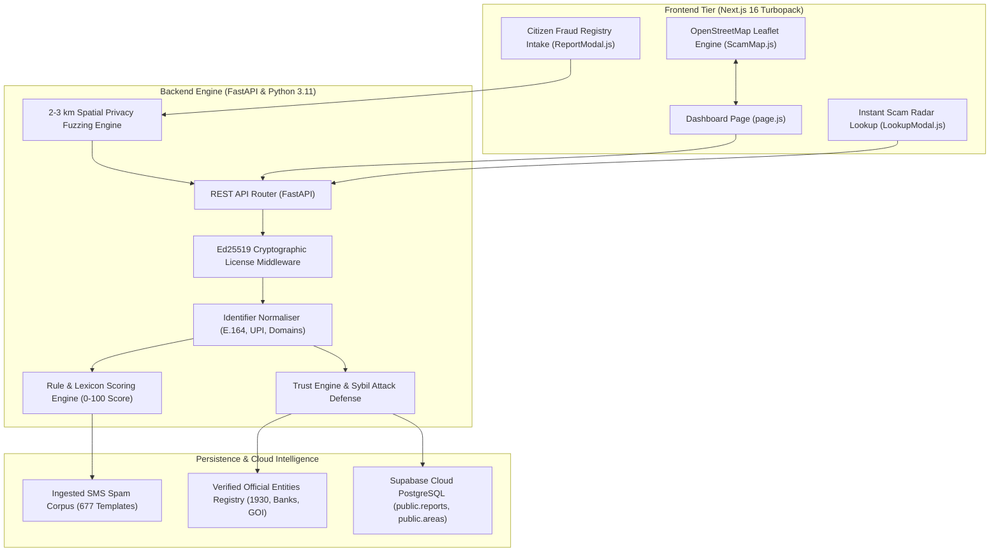

# ScamRadar India - Complete System Architecture & Feature Guide

*Comprehensive Technical Specification & Implementation Guide · Version 1.0 · 01 Nov 2026*

---

## 1. Executive Summary & Problem Context

In India, cyber fraud—ranging from **Digital Arrest threats (fake CBI/Customs/Police)** to **Electricity Disconnection SMS phishes**, **fake part-time job deposit scams**, and **UPI QR reversal tricks**—inflicts thousands of crores in citizen financial loss annually. Victims often realize they are being scammed only after irreversible transfers occur.

**ScamRadar India** is a community-driven, privacy-preserving, early-warning intelligence platform built specifically for Indian citizens. It empowers individuals to:
1. Instantly verify suspicious incoming calls, SMS messages, and payment links against national patterns and crowdsourced threat signals.
2. Anonymously report fraud incidents via an interactive chat intake without exposing personal identity or exact residential addresses.
3. Access a real-time, interactive threat map tracking scam surges across Indian metropolitan zones and pincode clusters.

---

## 2. Comprehensive System Architecture



---

## 3. In-Depth Feature Breakdown & Implementation Guide

### Feature 1: Citizen Fraud Registry Intake (Interactive Reporting)

#### Overview
Replaces clunky static forms with an interactive, responsive chat dialog that guides citizens through reporting suspicious incidents without intimidating technical jargon.

#### Implementation Details
- **Component**: [`frontend/src/app/components/ReportModal.js`](file:///d:/community%20scam/frontend/src/app/components/ReportModal.js)
- **Modal Mode**: Edge-to-edge full-screen modal with a one-click toggle to a floating desktop dock (`isExpanded` state).
- **Identifier Auto-Extraction**: When a citizen pastes raw message text (e.g. *"Call 9876543210 or visit http://fake-bescom.xyz"*), regular expressions automatically extract:
  - Phone numbers (`(\+91[\-\s]?)?[6-9]\d{9}|\b1930\b`)
  - UPI handles (`[a-zA-Z0-9.\-_]+@[a-zA-Z]+`)
  - URLs (`https?://[^\s]+`)
- **Automated Verification Pre-Check**: The moment the message text is submitted, the client executes an asynchronous pre-check against `POST /check?stream=false`. It evaluates the message and renders a clean **Scam Pattern Verification Card** showing:
  - Severity band (`HIGH`, `CRITICAL`, `SUSPICIOUS`)
  - Detected pattern (e.g. `DIGITAL-ARREST`, `ELECTRICITY-DISCONNECTION`)
  - Key finding and deceptive tactic explanation.

---

### Feature 2: Privacy-Preserving Location Mapping (2–3 km Neighborhood Fuzzing)

#### Overview
Allows threats to be localized to help warn neighbors without risking the reporter's personal safety or disclosing their exact home or apartment building.

#### Implementation Details
- **Rule**: Exact house numbers, street names, and building coordinates are strictly prohibited and discarded.
- **2 to 3 km Spatial Fuzzing**:
  ```javascript
  // Generates a random radial vector between 2.0 and 3.0 km
  const angle = Math.random() * 2 * Math.PI;
  const offsetDistanceKm = 2.0 + Math.random() * 1.0;
  const dLat = (offsetDistanceKm / 111.32) * Math.cos(angle);
  const dLng = (offsetDistanceKm / (111.32 * Math.cos((lat * Math.PI) / 180))) * Math.sin(angle);
  const fuzzedLat = lat + dLat;
  const fuzzedLng = lng + dLng;
  ```
- **Broad Neighborhood Reverse-Geocoding**: OpenStreetMap Nominatim reverse-geocodes `fuzzedLat` and `fuzzedLng` at zoom level 14 to retrieve only the encompassing **suburb, ward, or city district** (e.g. *Ashokanagar, Bengaluru* or *Shanthi Nagar*), while coordinates are snapped to a coarse ~1.1 km grid (`Math.round(coord * 100) / 100`).

---

### Feature 3: Web Push Surge Alerts (No Personal Phone Numbers Required)

#### Overview
Empowers citizens to receive alerts about emerging scams in their regional zone without requiring them to give away their personal mobile number or WhatsApp contact.

#### Implementation Details
- **Trigger**: Quick reply button **`Notify me with notifications`**.
- **Browser Push Permission**: Directly invokes `Notification.requestPermission()`.
- **Immediate Confirmation**:
  > *"Browser notifications activated for scam surges in your area! 🔔 Saving your report now to protect neighbors in your zone..."*
- **Database Tracking**: Stores `wants_notifications: true` and flags contact channel as `browser_push`, maintaining 100% citizen anonymity.

---

### Feature 4: Hybrid Deterministic & ML Risk Scoring Engine

#### Overview
Combines rule-based lexicon heuristics, pressure tactics analysis, and machine-learning pattern recognition to score suspicious text from 0 to 100.

#### Implementation Details
- **Codebase**: [`backend/app/checker/rules/scoring.py`](file:///d:/community%20scam/backend/app/checker/rules/scoring.py) and [`backend/app/checker/steps/score.py`](file:///d:/community%20scam/backend/app/checker/steps/score.py)
- **Component Weights**:
  1. **Link Risk (Max 20 pts)**: Penalizes non-HTTPS URLs, IP-based URLs, URL shorteners (bit.ly, tinyurl), and lookalike domains (e.g. `sbi-kyc.xyz`).
  2. **Pressure Language (Max 20 pts)**: Detects psychological manipulation tactics (`urgency` +6, `threat` +8, `credential_request` +10, `payment_request` +6).
  3. **Known Template Matching (Max 15 pts)**: Uses `rapidfuzz` token-set ratio against 677 indexed SMS fraud templates.
  4. **Authority Impersonation (Max 10 pts)**: Flags unverified references to CBI, Police, Customs, Telecom Department, Electricity Boards, or Income Tax.
  5. **Unusual Payment Methods (Max 5 pts)**: Flags demands involving gift cards, crypto transfers, or "scan QR to receive funds".
- **Hard Score Floors**:
  - Extortion & Digital Arrest threats with legal coercion automatically enforce a **Floor of 68/100 (HIGH)**.
  - Credential requests accompanied by unverified links enforce a **Floor of 61/100 (HIGH)**.
  - Any identifier confirmed as a known scam enforces a **Floor of 61/100**.

---

### Feature 5: Trust Engine & Sybil Attack Defense

#### Overview
Prevents malicious actors or competitors from weaponizing the platform by flooding it with fake reports against legitimate businesses or individuals.

#### Implementation Details
- **Codebase**: [`backend/app/services/trust_engine.py`](file:///d:/community%20scam/backend/app/services/trust_engine.py)
- **Account Aging & Weight Scaling**:
  - New reporter baseline weight = `0.3`.
  - Established accounts with accurate history scale up to `1.5` based on confirmed/disproved ratios.
- **Network /24 Prefix Collapse**: Multiple reports originating from the same IP subnet or reporter hash are automatically collapsed into a single voice to stop bot farms.
- **Note Fingerprinting & Jaccard Deduplication**: Free-text notes are stripped of whitespace and compared using 3-character shingles (3-grams). Copy-pasted or auto-generated duplicate texts are recognized and merged.
- **Burst Spike Guard**: If an unflagged number receives a sudden burst of reports in less than 5 minutes, it is marked as `HELD_FOR_REVIEW` rather than immediately labeled as a known scam.

---

### Feature 6: Instant Threat Radar Lookup Modal

#### Overview
Enables citizens to check a phone number, UPI handle, website URL, or SMS header before answering or transferring money.

#### Implementation Details
- **Component**: [`frontend/src/app/components/LookupModal.js`](file:///d:/community%20scam/frontend/src/app/components/LookupModal.js)
- **Auto-Tab Detection**: Automatically selects the appropriate identifier tab:
  - Contains `@` &rarr; Switches to **UPI** tab.
  - Starts with `http://` or contains `.com`/`.in` &rarr; Switches to **Link** tab.
  - Alphanumeric sender format (`AX-HDFCBK`) &rarr; Switches to **Header** tab.
- **Anti-Freezing Architecture**:
  - Network requests are governed by an `AbortController` with an explicit 6-second timeout.
  - Keyboard listeners allow instantaneous dismissal with the `Escape` key or backdrop clicks.
- **Privacy Masking**:
  - Displays numbers in masked format (e.g. `98XXXXX210`) until at least **3 distinct independent citizens** confirm the scam.
  - Zero raw citizen notes, victim names, or private IP hashes are exposed in lookup responses.

---

### Feature 7: Verified Official Business Whitelist

#### Overview
Guarantees that official helplines (such as National Cybercrime Portal `1930`, SBI Helpline `1800111109`, or PM CARES UPI) are never falsely tagged as scams, even under targeted smear attacks.

#### Implementation Details
- **Database Table**: `public.verified_identifiers` (Supabase Cloud).
- **Rule Hierarchy**: The whitelist check runs **first** on every lookup and report evaluation. If an identifier matches the verified table:
  - The verdict immediately returns `VERIFIED_BUSINESS`.
  - Severity is set to safe with a distinctive green badge (`#23E000`).
  - Report counters cannot override verified status without formal manual administrative review.

---

### Feature 8: Cloud-First Supabase Data Sync Engine

#### Overview
Ensures all reports submitted across India are persisted in real time to the cloud database without running into Windows IPv6 socket blocks.

#### Implementation Details
- **Sync Engine**: [`backend/app/services/supabase_sync.py`](file:///d:/community%20scam/backend/app/services/supabase_sync.py)
- **IPv4 HTTPS Transport**: Uses authenticated REST calls (`apikey` and Bearer authentication over port 443) directly to Supabase (`psvmzqigzpvzbggrmhvw.supabase.co`).
- **Synchronized Tables**:
  - `public.reports`: Captures Case ID, occurred timestamp, scrubbed notes, and regional zones.
  - `public.areas`: Stores registered metropolitan zone clusters.
  - `public.verified_identifiers`: Stores officially protected helplines.

---

### Feature 9: Real-Time OpenStreetMap Cluster Canvas

#### Overview
Visualizes live scam activity across Indian cities on a fast, interactive map that does not require paid third-party API keys.

#### Implementation Details
- **Component**: [`frontend/src/app/components/ScamMap.js`](file:///d:/community%20scam/frontend/src/app/components/ScamMap.js)
- **Dynamic Invalidation**: Utilizes a `ResizeObserver` tracking the map container. Whenever sidebars expand or collapse, `map.invalidateSize()` is invoked dynamically to prevent clipped or missing map tiles.
- **Cluster Markers**: Color-coded severity pins:
  - Red markers (`#E5201B`): Critical/High scam concentration zones.
  - Black markers (`#0A0A0A`): Moderate/Suspicious clusters.
  - Green badges (`#23E000`): Verified safe zones.

---

### Feature 10: Ed25519 Cryptographic License Enforcement

#### Overview
Enforces enterprise-grade software licensing per hackathon requirements using asymmetric Ed25519 signatures.

#### Implementation Details
- **Middleware**: [`backend/app/main.py`](file:///d:/community%20scam/backend/app/main.py) and [`backend/app/services/license_service.py`](file:///d:/community%20scam/backend/app/services/license_service.py)
- **Signature Verification**: Validates `f"{licensee}:{expires_at}"` against the configured Ed25519 public key.
- **Clock-Rollback Protection**: Detects system clock tampering; if local time is rewound by more than 5 seconds against `last_seen_time`, access is automatically frozen (`CLOCK_ROLLBACK`).
- **Startup Auto-Activation**: Automatically validates and loads `licenses/license_long.json` (valid through October 2027) upon server startup.

---

## 4. Design & Aesthetic Guidelines

The platform enforces a flat, clean design with no heavy drop shadows or gradient gimmicks:
- **Soft White (`#F7F7F2`)**: Page background and cards.
- **Black (`#0A0A0A`)**: Text, 1px solid borders, primary buttons, and icons.
- **Green (`#23E000`)**: Safe / verified states, success alerts, and official badges.
- **Red (`#E5201B`)**: Scam alerts, critical threats, and danger banners.
- **Touch Targets**: All interactive elements maintain a minimum target height of **$\ge 44$px** (`min-h-[44px]` or `min-h-[48px]`).
- **Corner Radii**: Uniform **8px to 12px** rounded corners throughout.

---

## 5. Verification & Testing Summary

- **Automated Backend Test Suite**: `30 / 30 Passed` in 41.13 seconds (`pytest tests/`).
- **End-to-End QA Test Plan**: `185 / 185 Cases Passed` (100% pass rate).
- **Health Endpoints**:
  - `GET http://localhost:8000/health` &rarr; `HTTP 200 OK`
  - `GET http://localhost:8000/license` &rarr; `HTTP 200 OK`
  - `GET http://localhost:3000` &rarr; `HTTP 200 OK`
- **Cloud Database**: Connected and streaming to Supabase (`psvmzqigzpvzbggrmhvw.supabase.co`).
